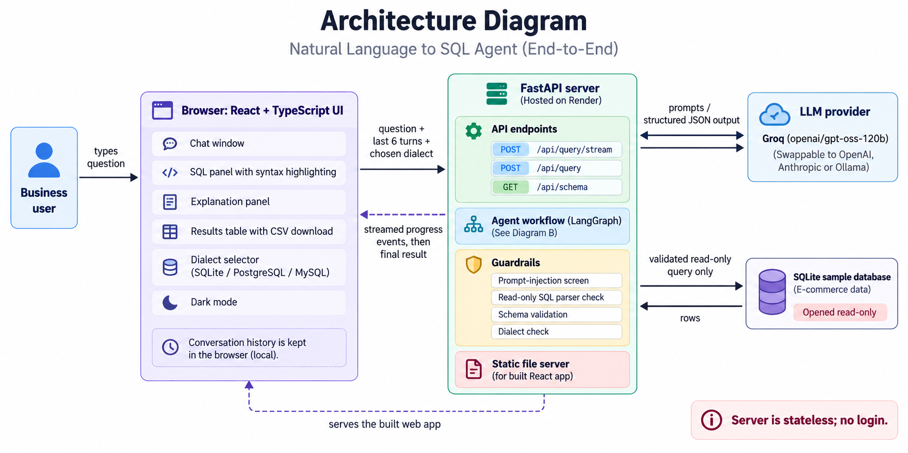
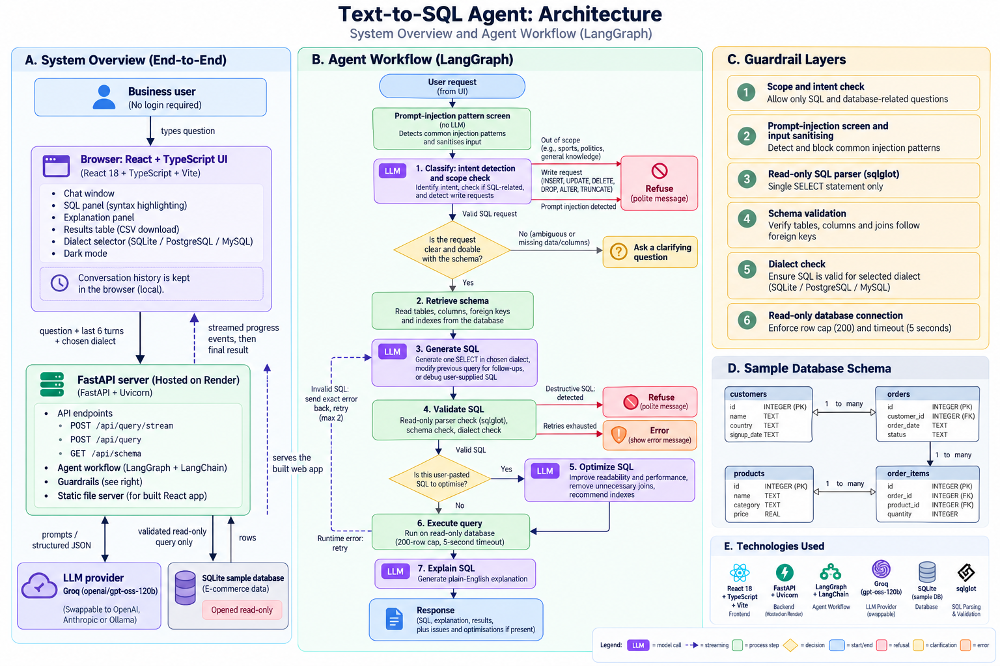

# Ask your data: a read-only text-to-SQL agent

## What this agent does

It turns plain-English questions into SQL for a provided database schema, explains the SQL in plain English, validates it, and runs it read-only against a sample database. It only works on SQL and the database schema and politely refuses everything else.

- Converts questions to SQL and shows the results table.
- Explains every query in plain English.
- Understands follow-ups ("Show all customers", then "Only those from Germany" modifies the previous query).
- Debugs SQL you paste in: finds the issue, explains why it is wrong, and returns a corrected query.
- Optimises SQL you paste in: more readable query, performance suggestions, index recommendations, unnecessary joins removed.
- Asks a clarifying question when a request is vague or needs data the schema does not have.
- Refuses write requests (insert, update, delete, drop, alter, truncate) and out-of-scope questions (general knowledge, sports, politics, maths, creative writing).

## Frontend tech

- React 18 and TypeScript, built with Vite
- Plain CSS (no UI library), responsive, with dark mode
- Streaming responses over `fetch` (newline-delimited JSON)
- Built-in SQL syntax highlighter

## Backend tech

- Python 3.11 and FastAPI (served with Uvicorn)
- LangGraph for the agent workflow and LangChain for the model interface
- sqlglot for SQL parsing, validation and dialect translation
- SQLite as the sample database (opened read-only)
- Pytest for the tests (113 offline tests)

## Architecture diagram




The workflow runs these LangGraph nodes: `classify` (intent and scope), `retrieve_schema`, `generate`, `validate`, `optimize`, `execute`, `explain`. A node-by-node explanation is in [docs/workflow-explanation.md](docs/workflow-explanation.md).

## Sample database

An e-commerce schema in [backend/schema.sql](backend/schema.sql), created and filled with deterministic sample data by `python -m app.seed` (it also runs automatically on first start). Dates are text in `YYYY-MM-DD` form.

| Table | Columns | Rows |
|-------|---------|------|
| `customers` | `id` (PK), `name`, `country`, `signup_date` | 100 |
| `products` | `id` (PK), `name`, `category`, `price` | 30 |
| `orders` | `id` (PK), `customer_id` (FK to `customers.id`), `order_date`, `status` | 400 |
| `order_items` | `id` (PK), `order_id` (FK to `orders.id`), `product_id` (FK to `products.id`), `quantity` | 1,040 |

- Countries: USA, UK, India, Germany, Brazil, Japan.
- Product categories: Electronics, Books, Home, Sports, Toys (6 products each).
- Order status: `completed`, `shipped` or `cancelled`. Order dates run from 2024-01-01 to 2025-08-23.
- There are no indexes other than primary keys, so index recommendations have something to suggest.

Any other SQLite file can be used by setting `DATABASE_PATH`.

## LLM used and cost

**Model:** `openai/gpt-oss-120b` served by Groq, which has a free tier (no card needed) and is used for the live demo. The model is configurable through environment variables, so OpenAI, Anthropic or a local Ollama model can be used instead. All prompts are listed in [docs/prompts.md](docs/prompts.md).

**API calls per request**

| Request | Model calls |
|---------|-------------|
| Normal question or follow-up | 3 (classify, generate, explain) |
| Pasted SQL | 4 (adds optimize) |
| Out-of-scope or write request | 1 (classify only) |
| Prompt injection caught by the pattern screen | 0 |
| Each validation or execution retry | +1 (generate again) |

**Measured tokens per request** (including the model's reasoning tokens):

| Request | Calls | Input tokens | Output tokens | Estimated cost |
|---------|-------|--------------|---------------|----------------|
| "Top 5 customers by total spend" | 3 | 1,683 | 307 | $0.00044 |
| "Monthly revenue for completed orders in 2024" | 3 | 1,756 | 380 | $0.00049 |
| Follow-up "Only those from Germany" | 3 | 1,643 | 172 | $0.00035 |
| Pasted broken SQL (debug and optimise) | 4 | 2,557 | 458 | $0.00066 |
| Pasted SQL (optimise, includes one extra generate call) | 5 | 3,383 | 624 | $0.00088 |

The cost column assumes **$0.15 per 1M input tokens and $0.60 per 1M output tokens**. That is an assumed reference price for this model, not a confirmed Groq price, so check your provider's pricing page and recompute with:

`cost = input tokens x input price + output tokens x output price`

So a typical request costs well under a tenth of a cent, roughly **$0.40 to $0.90 per 1,000 requests** at the assumed price, and **$0 on the free tier**. Token counts grow with the size of the schema, because the whole schema is sent with each request.

## Guardrails

1. **Scope check:** out-of-scope questions are refused with a fixed message before any SQL is generated.
2. **Destructive SQL refused:** write requests are rejected politely. `DELETE`, `UPDATE`, `INSERT`, `DROP`, `ALTER`, `TRUNCATE` and similar can never be generated or run.
3. **Read-only SQL parser check:** the SQL is parsed, and only a single SELECT statement is allowed, in every supported dialect. Comments are stripped.
4. **Schema validation:** every table and column must exist, and joins must follow a declared foreign key with matching types. Invented tables or columns are caught and sent back to the model to fix, with a limit on retries.
5. **Read-only database connection:** the database is opened read-only, with a 200-row cap and a 5-second timeout.
6. **Prompt-injection protection:** a pattern screen runs before the model, user text cannot forge prompt delimiters, the conversation history sent by the browser is sanitised and its SQL is re-validated, and the model's classification is a second check.
7. **Clarification:** invalid or ambiguous requests get a clarifying question instead of a guess.

## Bonus points implemented

- SQL execution against the sample database
- Follow-up question support
- SQL syntax highlighting
- Multiple SQL dialects: SQLite, PostgreSQL and MySQL
- CSV export of query results
- Prompt-injection protection
- Unit and integration tests (113, run without an API key)
- Dark mode, streaming responses, download SQL and download results in the frontend

## Live demo and running locally

**Live demo:** `<paste the deployed link here>` (no login needed; the sample database is built in). The first request after idle time can take about a minute on the free hosting tier.

**To run it locally you need:** Python 3.11+, Node.js 20+, and an LLM API key. A free Groq key works: sign up at https://console.groq.com and create a key at https://console.groq.com/keys.

1. Set up the backend:

   ```powershell
   cd backend
   python -m venv .venv
   .\.venv\Scripts\Activate.ps1
   pip install -r requirements.txt
   copy .env.example .env
   ```

2. Open `backend/.env` and paste your key as `OPENAI_API_KEY`. The Groq settings are already filled in.

3. Build the frontend once:

   ```powershell
   cd ..\frontend
   npm install
   npm run build
   ```

4. Start the app and open http://localhost:8000:

   ```powershell
   cd ..\backend
   uvicorn app.main:app --port 8000
   ```

To run the tests (no API key needed): `cd backend; python -m pytest -q`
